# 🐉 contribution-dragon

> Your GitHub contribution graph, guarded by an animated dragon.
> A self-built generator — no snake libraries, no JavaScript in the output:
> everything compiles to pure SVG + SMIL, so it animates inside any GitHub README.



---

## Features

- **Hunting choreography — burns EVERYTHING before reset** — the dragon
  hunts session after session: fade-in outside a side edge → sweep
  **20–30 serpentine steps** → breathe fire → wander → teleport on.
  Each session targets the densest cluster of UNBURNED bright cells and
  aims every blast ray at still-lit dots, so the loop only ends when
  **every bright cell of this repo's graph has burned** — then the board
  resets. Cycle length adapts to the repo's activity (capped at 40
  sessions).
- **Rotating flamethrower** — at each hunting ground the dragon turns
  through a **random 1–4 directions**, each blast covering a **random
  1–3 cell range**. Directions whose whole flame cone would leave the grid
  are skipped automatically.
- **Burn state machine on cells** — every cell on the fire path plays:
  `INTACT → BURNING (flame icon burns on the cell for 0.5 s) → SCORCHED
  (charred tint held until the cycle resets)`. Bright cells lose their
  color **gradually, nearest cell first** (0.24 s stagger, 0.35 s fade).
- **Vector head + rope-constraint tail chain** — the head is a position +
  heading vector; its rotation follows its velocity vector (normalized to
  ±90° with a mirror-flip, so it never flies upside down). The tail is a
  13-segment chain linked tail-to-head by a rope-constraint simulation
  (0.15 s steps) — segments trail the head's historical path exactly.
- **Spin-in entrances** — ~55% of teleports arrive with a full 360° twirl
  (random direction); accumulated angles stay multiples of 360° so loops
  are seamless.
- **Redesigned board** — rounded cells, glow ring behind peak-activity
  days, month labels, contribution counter.
- **Zero dependencies** — one GraphQL call, everything else is hand-rolled
  TypeScript. The output is a single self-contained SVG.

## Movement logic (the choreography)

Each cycle (~33–40 s, deterministic per seed) compiles into a timeline of
phases; the head's position is a piecewise-linear function of time and the
tail is simulated against it:

```
FADE-IN          arrive outside the grid boundary (55%: + 360° spin-in)
ENTER            cross the boundary at the nearest edge cell
SWEEP            glide a serpentine of 20–30 steps from a SIDE edge to
                 the spray origin — movement is Ox-preferred: arrivals
                 sit outside the left/right borders, sweeps and wanders
                 run mostly horizontal (~75% of path length); wave bends
                 every few hops, amplitude widens to 2 cells on short
                 spans so the head never wiggles in place
AIM + SPRAY      rotate 0.14 s → breathe fire 1.34–1.56 s → 3–5 rays
                 aimed at still-burning dots (range locked onto the
                 farthest lit cell on each ray)
                 (fire path = every cell in range; bright cells start a
                 sequential color-loss wave, nearest first)
HOLD             0.5 s + (farthest cell's fade completion) — the body
                 holds its pose instead of coiling
WANDER           2–4 random walk steps (may poke outside the boundary)
VANISH           fade-out → invisible slide → next hunting ground
```

The tail chain: segment *k* is re-attached each simulation step to sit
exactly `spacing` behind segment *k-1* along the line joining them; while
the head holds still the body **keeps its pose** instead of coiling.
Cycle-boundary snaps (segments returning to their spawn stack) happen only
during invisible slides.

## Setup — GitHub Action (recommended)

In the repo where you want the dragon (usually your profile repo,
`YOU/YOU`), create `.github/workflows/dragon.yml`:

```yaml
name: Contribution Dragon
on:
  schedule:
    - cron: '23 2 * * *'        # daily refresh
  workflow_dispatch:
  push:
    branches: [main]
permissions:
  contents: write
jobs:
  generate:
    runs-on: ubuntu-latest
    steps:
      - uses: actions/checkout@v4
      - uses: phamdung2301/contribution-dragon@main
        with:
          user: YOUR_USERNAME
          token: ${{ secrets.GITHUB_TOKEN }}
          out-dark: dist/dragon-dark.svg
          out-light: dist/dragon-light.svg
      - uses: crazy-max/ghaction-github-pages@v4
        with:
          target_branch: output
          build_dir: dist
        env:
          GITHUB_TOKEN: ${{ secrets.GITHUB_TOKEN }}
```

Then embed from the `output` branch:

```html

```

### Action inputs

| Input | Required | Description |
|---|---|---|
| `user` | ✔ | GitHub username whose graph the dragon guards |
| `token` | ✔ | `secrets.GITHUB_TOKEN` works out of the box |
| `out-dark` | — | Output path for the dark-theme SVG (skip to disable) |
| `out-light` | — | Output path for the light-theme SVG |
| `show-count` | — | `true`/`false` — the "N contributions" label |

## Setup — CLI

```bash
npm i -g phamdung2301/contribution-dragon

contribution-dragon --user YOUR_USERNAME --token ghp_xxx --theme dark --out dragon.svg
contribution-dragon --fixture --theme light --out demo.svg     # no token needed
contribution-dragon --user YOU --token ghp_xxx --seed 777 --out dragon.svg
```

| Flag | Description |
|---|---|
| `--user` | GitHub username |
| `--token` | Token with `read:user` scope (or `GH_TOKEN` env) |
| `--fixture` | Render the deterministic demo calendar instead of fetching |
| `--theme` | `dark` or `light` |
| `--seed` | Seed the choreography RNG (same seed = same flight plan) |
| `--out` | Output file |
| `--no-count` | Hide the contributions label |

## How it works

1. **Fetch** — one GraphQL call: `contributionsCollection.contributionCalendar`.
2. **Choreograph** — pick bright-cell targets, plan entry/away/origin
   béziers, spray directions (validated to stay inside the grid), walk
   steps; every phase gets a start/end time.
3. **Simulate the chain** — sample the head at 0.15 s steps; re-attach each
   tail segment behind its leader (rope constraint), holding pose when the
   head is still.
4. **Compile to SMIL** — each segment becomes its own `animateMotion` with
   `keyPoints`/`keyTimes`; each burned cell gets its fill-flame and scorch
   animations baked into full-cycle `keyTimes`. Zero runtime JS.

## Debug tooling

```bash
node tools/trace-head.mjs     # every phase + head position per second
node tools/debug-chain.mjs    # colored chain frames + head-to-tail stretch
node tools/analyze-live.mjs   # % of time the head spends inside the grid
```

## License

MIT
